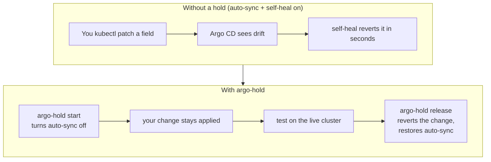

# argo-hold

[](https://github.com/markddavidoff/argo-hold/actions/workflows/ci.yml)
[](LICENSE)

[](https://github.com/markddavidoff/argo-hold/releases)

**Try an infrastructure change on a live, Argo CD-managed cluster before it merges to Git —
then put everything back.**

You changed a Helm value or patched a resource and want to watch it behave on the real
cluster before you open the PR. But the app has Argo CD auto-sync with self-heal on, so your
`kubectl` edit is reverted within seconds. `argo-hold` turns that one app's auto-sync off,
keeps your change applied for as long as you need (bounded by a TTL), and on `release`
reverts the change and restores the sync policy. It never edits Git.


*The demo runs against a fake cluster. No real cluster is touched.*



## New to Argo CD?

[Argo CD](https://argo-cd.readthedocs.io/) keeps a cluster matching the manifests in a Git
repo. When an Application has an
[automated sync policy](https://argo-cd.readthedocs.io/en/stable/user-guide/auto_sync/),
`selfHeal: true` makes Argo CD revert any live change that drifts from Git (that is what
undoes your `kubectl` edit), and `prune: true` deletes resources that are no longer in Git.
`argo-hold` pauses that automation for one app, temporarily, so a live change survives long
enough to test.

## Limits worth knowing first

- **The TTL is enforced client-side.** The holder process on your machine turns auto-sync
  back on when the TTL expires. If your machine sleeps or loses its network, auto-sync
  stays off until the machine is back and you run `argo-hold release --app NAME` (which works
  from the saved state file, even after the holder is gone). There is no cluster-side expiry.
- **Releasing a freeze syncs everything at once.** When `release` turns auto-sync back on,
  Argo CD syncs every change that merged to Git while the hold was active, together.
- **Interactions with ApplicationSet and app-of-apps are untested.** A parent that re-renders
  the Application, and `ignoreDifferences` with `RespectIgnoreDifferences`, have not been
  verified. See [limits and unverified behavior](docs/how-it-works.md#limitations-and-observations).
- **Test evidence is from one cluster.** See [Tested versions](#tested-versions).

## Quick start

`argo-hold` needs Python 3.10+, `kubectl` with access to your context, and Argo CD running
in the cluster (namespace `argo-cd` by default; pass `--argocd-namespace` for a stock
`argocd` install). Install it (see [Install](#install)), then:

```bash
# 1. Plan only. Prints the context, app, touched paths, and release behavior; changes nothing.
argo-hold start --app web --context my-context \
  --target deployment/web -n web --type merge \
  --patch '{"spec":{"replicas":3}}' --dry-run

# 2. Run it for real. Confirm at the prompt; the holder keeps running in the background.
argo-hold start --app web --context my-context \
  --target deployment/web -n web --type merge \
  --patch '{"spec":{"replicas":3}}' --detach

# 3. Test whatever you came to test, then undo everything.
argo-hold status --app web
argo-hold release --app web
```

A hold ends on its own after `--ttl` (default 2h). While it lasts, the app gets no other
GitOps changes, so keep it short. Read [Safety](#safety) before pointing this at a shared
cluster.

### Try it without a cluster

- **The demo:** `make demo` renders a short GIF of a full hold cycle against a fake
  `kubectl` (needs [vhs](https://github.com/charmbracelet/vhs); nothing real is touched).
  The tape is in [`demo/demo.tape`](demo/demo.tape).
- **A throwaway real cluster:** `make test-k3d` spins up a local [k3d](https://k3d.io)
  cluster with Argo CD and runs the integration tests against it (needs docker, k3d, and
  network). See [`docs/k3d-findings.md`](docs/k3d-findings.md).

## Why not just...

Each alternative is real and sometimes the right call. `argo-hold` fills one narrow gap: a
short, reversible, ad-hoc live test of a change you have **not** yet committed to Git.

| Instead of a hold | What it does | Reach for it when |
|---|---|---|
| `argocd app set <app> --sync-policy none` (or the UI auto-sync toggle) | Sets the sync policy to manual, so self-heal stops reverting edits ([`none` is an alias of `manual`](https://argo-cd.readthedocs.io/en/stable/user-guide/commands/argocd_app_set/)). | You want to turn automation off for a while and will revert your edit and re-enable the policy yourself. `argo-hold` adds a TTL, an automatic revert of both the edit and the exact prior policy, and refusals for sensitive apps. |
| [`spec.ignoreDifferences`](https://argo-cd.readthedocs.io/en/stable/user-guide/sync-options/) in the Application | Tells Argo CD to ignore specific fields when it computes sync status (and, with `RespectIgnoreDifferences`, when it applies). Lives in Git. | A field should *always* be ignored, as committed policy — not for a one-off test. |
| [Sync windows](https://argo-cd.readthedocs.io/en/stable/user-guide/sync_windows/) in the AppProject | Time-based allow/deny windows that gate when syncs run, by selector. | You need recurring, scheduled freeze periods across apps — not an ad-hoc hold on one app. |
| `kubectl patch` with auto-sync + self-heal on | Your edit is reverted within seconds (about 1s on the k3d test cluster). | This is the problem `argo-hold` exists to solve. |
| [Tilt](https://tilt.dev/), [Skaffold](https://skaffold.dev/), [Telepresence](https://telepresence.io/) | Local development inner-loop tools that deploy your working copy to a cluster. | You are iterating on application code, not testing an infra change against the GitOps-managed app. |

**When `argo-hold` is the wrong tool:** if the change should be permanent, commit it to Git
and let Argo CD sync it. `argo-hold` is only for a temporary, reversible test before merging.

## Install

```bash
brew install markddavidoff/tap/argo-hold
```

Or from source, with no dependencies to build:

```bash
git clone https://github.com/markddavidoff/argo-hold.git
cd argo-hold
./install.sh                  # symlinks argo-hold into ~/.local/bin
```

<details>
<summary>Other install options</summary>

```bash
./install.sh --prefix DIR     # symlink into DIR/bin instead
./install.sh --uninstall
```

The tool is standard-library-only Python; `install.sh` just symlinks the launcher, with no
sudo and no dependencies to build.
</details>

## How it works

`argo-hold` turns one Application's `spec.syncPolicy.automated` off, applies your change, and
runs a **holder** process that re-disables auto-sync and re-applies the change whenever
something reverts them. `release` restores the original policy and reverts the change from a
saved state file, so it works even after the holder has crashed. The revert never relies on
Argo CD to undo the change.

Read [`docs/how-it-works.md`](docs/how-it-works.md) for the start sequence, the holder's
watchers/reactor/timer, the no-clobber revert rule, freeze mode, failure modes, and the k3d
findings behind these rules.

## Usage

```bash
argo-hold start  --app NAME --context CTX \
                 --target KIND/NAME -n NS (--patch JSON | --patch-file FILE) --type merge|json|strategic
argo-hold start  --app NAME --context CTX -f MANIFEST
argo-hold start  --app NAME --context CTX --freeze     # no change; only keep auto-sync off
argo-hold status --app NAME
argo-hold release --app NAME [--force]
argo-hold list
argo-hold --version
```

A typical session: `start --dry-run` to see the plan, post the on-call notice (a team
convention; see [Safety](#safety)), `start --detach` to run it, `status` to watch it, and
`release` to undo it.

<details>
<summary><code>start</code> flags</summary>

| Flag | Meaning |
|---|---|
| `--app APP` | The Argo CD Application to hold. Required. |
| `--context CONTEXT` | The kube context. Required; printed before anything changes. |
| `-n`, `--namespace NS` | Namespace of the target objects. |
| `--argocd-namespace NS` | Namespace Argo CD runs in. Default `argo-cd`; overrides `ARGO_HOLD_ARGOCD_NAMESPACE`. `status` and `release` use the value recorded when the hold started. |
| `--target KIND/NAME` | An object to change. Repeat for more than one. |
| `--patch JSON` | Patch body as JSON. |
| `--patch-file FILE` | File that holds the patch body as JSON. |
| `-f`, `--filename FILE` | A manifest. Targets come from the manifest, so `--target` and `--type` are rejected. An object that does not exist is created; one that exists is merge-patched. |
| `--freeze` | Apply no change: only turn auto-sync off and keep it off. Rejects `--target`, `-n` and `--type`. `release` turns auto-sync back on, and every change pending in Git syncs at once. |
| `--type merge\|json\|strategic` | Patch type. Required with `--patch` and `--patch-file`. |
| `--ttl 2h` | Time until the hold releases itself. Accepts `s`, `m`, `h` suffixes. Default `2h`. |
| `--interval 60` | Heartbeat and safety-resync period in seconds. Default `60`. |
| `--wait-op 5m` | How long to wait for a running sync before giving up. Default `5m`. |
| `--dry-run` | Print the plan and stop. Nothing is changed. |
| `--detach` | Run the holder in the background after you confirm. |
| `--yes` | Skip the confirmation prompt. |
| `--allow-sensitive` | Allow the denylisted apps. |

Exactly one of `--patch`, `--patch-file`, `-f`, and `--freeze` is required.

`release` signals a live holder and waits for it to revert; if the holder is gone, it reverts
from the state file. A field that someone else changed during the hold is skipped with a
warning; `--force` overwrites it. Releasing a freeze prints a `NOTICE:` line first.
</details>

<details>
<summary>Environment variables</summary>

| Variable | Default | Effect |
|---|---|---|
| `ARGO_HOLD_STATE_DIR` | `$HOME/.local/state/argo-hold` | Where state and log files live. |
| `ARGO_HOLD_KUBECTL` | `kubectl` | The `kubectl` binary to run; the tests point it at a fake. |
| `ARGO_HOLD_ARGOCD_NAMESPACE` | `argo-cd` | Namespace Argo CD runs in, for `start`. `--argocd-namespace` overrides it. A stock Argo CD install uses `argocd`. |
| `ARGO_HOLD_DENYLIST_EXTRA` | unset | Comma- or space-separated app names to refuse in addition to the built-in denylist (`argo-cd`, `app-root`, `external-secrets`). `--allow-sensitive` overrides them. |
| `ARGO_HOLD_ONCALL_CHANNEL` | `#on-call` | The on-call channel that `start` names on the `on-call:` line of its plan output. A blank value uses the default. The tool never posts to it. |
</details>

<details>
<summary>Exit codes</summary>

| Code | Meaning |
|---|---|
| 0 | Success |
| 1 | Error or refusal |
| 2 | Usage error |
| 3 | Finished with warnings; the state file is kept (`release --force` finishes the job), or `status` found a dead or stale holder |
</details>

## Example session

Recorded against the test suite's fake `kubectl`, so the context is `test-ctx` and the
objects are the test fixtures. The code path is identical against a real cluster; only the
context name and object contents differ.

```text
$ argo-hold start --app otel-collector --context test-ctx --target daemonset/otel-collector-logs \
    -n monitoring --type strategic \
    --patch '{"spec":{"template":{"spec":{"affinity":{"nodeAffinity":{"requiredDuringSchedulingIgnoredDuringExecution":{"nodeSelectorTerms":[{"matchExpressions":[{"key":"gke-nodepool","operator":"NotIn","values":["infra-pool"]}]}]}}}}}}}' \
    --dry-run
context:   test-ctx
app:       otel-collector (namespace argo-cd)
ttl:       2h    interval: 60s
on-call:   #on-call (post the on-call notice here before a live start)
auto-sync: will be turned OFF
target:    daemonset/otel-collector-logs -n monitoring
             add      /spec/template/spec/affinity  (object(1 keys))
dry-run: nothing was changed

$ argo-hold status --app otel-collector
app:         otel-collector   context: test-ctx
holder:      pid 63056 (live), phase holding
heartbeat:   1s ago (interval 60s)
ttl left:    1h 59m
activity:    0 auto-sync re-disable(s), 0 re-apply(s)
live:        auto-sync off, sync status Synced

$ argo-hold release --app otel-collector
releasing otel-collector on context test-ctx
released
```

The log shows paths and counts, never values:

```text
holding otel-collector on test-ctx; ttl 2h; release with: argo-hold release --app otel-collector
releasing (signal SIGTERM)
daemonset/otel-collector-logs: reverted 2 op(s)
otel-collector: restored spec.syncPolicy.automated
otel-collector: requested hard refresh
released
```

### Freeze, step by step

Same fake `kubectl`. The app is `app-root`, which is on the denylist, so `--allow-sensitive`
is required. A freeze applies no change; it only keeps auto-sync off.

```text
$ argo-hold start --app app-root --context test-ctx --freeze --allow-sensitive --dry-run
context:   test-ctx
app:       app-root (namespace argo-cd)
ttl:       2h    interval: 60s
on-call:   #on-call (post the on-call notice here before a live start)
mode:      freeze (no change is applied; only auto-sync is turned off)
auto-sync: will be turned OFF
release:   turns auto-sync back on and requests a hard refresh; EVERY change pending in git for app-root syncs at once
dry-run: nothing was changed

$ argo-hold release --app app-root
releasing app-root on context test-ctx
NOTICE: releasing the freeze on app-root turns auto-sync back on, and a hard refresh is requested: every change pending in git syncs at once
released
```

Holds on different apps are independent — each has its own state file, holder, and TTL — so a
freeze on a parent app and a patch hold on a child can run at the same time and release in
either order.

## Tested versions

Only these were observed; everything else is **not tested**. The real-cluster evidence is one
k3d run (see [`docs/k3d-findings.md`](docs/k3d-findings.md)).

| Component | Tested | How |
|---|---|---|
| Python | 3.10, 3.11, 3.12, 3.13, 3.14 | CI, every push |
| Argo CD | v2.12.4 | one k3d run |
| kubectl (client) | v1.33.9 | one k3d run |
| k3s (via k3d) | v1.35.5 | one k3d run |
| Cloud providers, managed Argo CD, other Argo CD versions | not tested | — |

## RBAC

`argo-hold` acts as whoever runs it. It needs `get`/`list`/`watch`/`patch` on the Argo CD
`Application`, and `get`/`list`/`watch`/`patch` (plus `create`/`delete` for `-f`) on each
target object. [`docs/rbac.md`](docs/rbac.md) has a minimal Role and `kubectl auth can-i`
checks. The Role is derived from reading the code and has not been tested against a
restricted account.

## Safety

- `--context` is required and printed with the app and targets before anything changes.
  `start` asks for confirmation unless `--yes` is set.
- One hold per app. A second `start` for the same app is refused.
- A hold ends on its own after `--ttl` (default 2h).
- `argo-cd`, `app-root`, and `external-secrets` are refused without `--allow-sensitive`, as is
  any app named in `ARGO_HOLD_DENYLIST_EXTRA`. This includes `--freeze`.
- Targets of kind `Secret` are refused.
- Logs, `--dry-run` output, and `status` show paths, operations, and value shapes, never
  values. The state file (mode 0600) holds the values at the touched paths. Patch bodies
  appear in the `kubectl` command line while a command runs.
- Writes use `kubectl patch` or server-side apply with field manager `argo-hold`. The tool
  never runs client-side `kubectl apply` on Argo-managed objects.
- The tests never touch a production cluster. The unit tests use a fake `kubectl`; the opt-in
  integration test uses a throwaway local k3d cluster.

**About the on-call notice:** announcing a hold in an on-call channel is a *team convention*,
not something the tool does or checks. `argo-hold` only prints the channel name on the
`on-call:` line of its plan, from `ARGO_HOLD_ONCALL_CHANNEL` (default `#on-call`); it never
posts to Slack and never verifies that a post exists. The notice is optional from the tool's
point of view — adopt it if your team wants it. The [agent prompts](docs/agent-prompts.md)
include the post as a step because they are written for teams that require it.

## Tests

```bash
make test       # pytest suite on a fake kubectl; no cluster needed
make test-k3d   # opt-in: throwaway local k3d with Argo CD; needs docker, k3d, network
```

## More

- [`docs/README.md`](docs/README.md): documentation index.
- [`docs/how-it-works.md`](docs/how-it-works.md): start sequence, the holder, the revert,
  failure modes, and what is unverified.
- [`docs/rbac.md`](docs/rbac.md): minimal Role and access checks.
- [`docs/agent-prompts.md`](docs/agent-prompts.md): prompts that let a coding agent run a
  whole hold cycle.
- [`docs/k3d-findings.md`](docs/k3d-findings.md): what the k3d runs observed.
- [`CHANGELOG.md`](CHANGELOG.md) and [`RELEASING.md`](RELEASING.md).

## License

[MIT](LICENSE).
